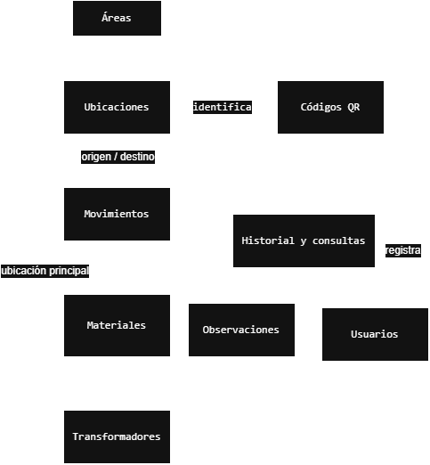

# Módulos del Sistema

## Índice

- [Objetivo](#objetivo)
- [Módulos principales](#módulos-principales)
- [Relación entre módulos](#relación-entre-módulos)
- [Diagrama de interacción entre módulos](#diagrama-de-interacción-entre-módulos)

## Objetivo

Este documento define los principales módulos funcionales previstos para el desarrollo del sistema web de trazabilidad de materiales.

La división en módulos busca organizar el desarrollo, separar responsabilidades y facilitar futuras ampliaciones del sistema a otras áreas productivas.

## Módulos principales

### Usuarios

Responsable de gestionar los usuarios habilitados para utilizar el sistema.

Contemplará:

- Registro y administración de usuarios.
- Identificación de usuarios.
- Roles de Administrador y Operario.
- Control de acceso según el rol.

### Áreas

Responsable de administrar las áreas productivas en las que podrá utilizarse el sistema.

La primera implementación utilizará el área de Terminación.

La estructura permitirá incorporar posteriormente otras áreas como Bobinado, Montaje Parte Activa y Preestabilizado.

### Ubicaciones

Responsable de gestionar las ubicaciones físicas donde pueden encontrarse los materiales.

Contemplará:

- Alta y modificación de ubicaciones.
- Ubicaciones principales.
- Ubicaciones temporales.
- Asociación con áreas.
- Identificación mediante códigos QR.

### Transformadores

Responsable de gestionar los transformadores incluidos dentro del sistema.

Contemplará:

- Registro mediante el número real del transformador.
- Identificación del proveedor asociada, por ejemplo UN20 o K486.
- Ubicación principal.
- Estado activo dentro del proceso.
- Consulta de materiales asociados.

### Materiales

Responsable de gestionar los materiales asociados a cada transformador.

Contemplará:

- Registro de materiales.
- Tipo o descripción.
- Asociación con un transformador.
- Consulta de ubicación actual.
- Consulta de historial.

### Movimientos

Responsable de registrar los cambios de ubicación de los materiales.

Contemplará:

- Ingreso.
- Traslado interno.
- Devolución a depósito.
- Pase a despacho.
- Ubicación de origen.
- Ubicación de destino.
- Usuario responsable.
- Fecha y hora.

Cada movimiento actualizará la ubicación actual del material y será conservado como parte de su historial.

### Observaciones

Responsable de registrar información adicional relacionada con materiales o movimientos.

Las observaciones serán de texto libre y conservarán información sobre el usuario y el momento en que fueron registradas.

### Códigos QR

Responsable de facilitar el acceso rápido a las ubicaciones físicas.

Los códigos QR estarán asociados a ubicaciones y no individualmente a los materiales.

Al escanear un QR, el usuario podrá identificar la ubicación correspondiente y acceder a las operaciones disponibles.

### Historial y consultas

Responsable de permitir la consulta de la información registrada por el sistema.

Contemplará:

- Consulta de ubicación actual de materiales.
- Historial de movimientos.
- Materiales asociados a un transformador.
- Movimientos asociados a una ubicación.
- Identificación del usuario que realizó cada registro.

## Relación entre módulos

Los módulos estarán relacionados entre sí a través del modelo de datos y de la lógica de negocio del backend.

Las principales relaciones son:

- Áreas agrupa las ubicaciones disponibles.
- Ubicaciones participa en el registro de movimientos como origen o destino.
- Los códigos QR permiten identificar rápidamente una ubicación.
- Transformadores agrupa los materiales correspondientes a cada transformador.
- Transformadores se relaciona con Ubicaciones mediante la ubicación principal.
- Materiales utiliza Movimientos para conservar sus cambios de ubicación.
- Usuarios registra movimientos y observaciones.
- Observaciones aporta información adicional sobre materiales y movimientos.
- Historial y consultas utiliza la información registrada por Materiales, Movimientos y Ubicaciones.

## Diagrama de interacción entre módulos

El siguiente diagrama muestra las principales dependencias e interacciones entre los módulos del sistema.

[Archivo editable en diagrams.net](diagramas/modulos-interaccion.drawio)

La arquitectura y las relaciones de datos se encuentran documentadas en:

- [Modelo de datos](modelo-datos.md)
- [Arquitectura del sistema](arquitectura.md)